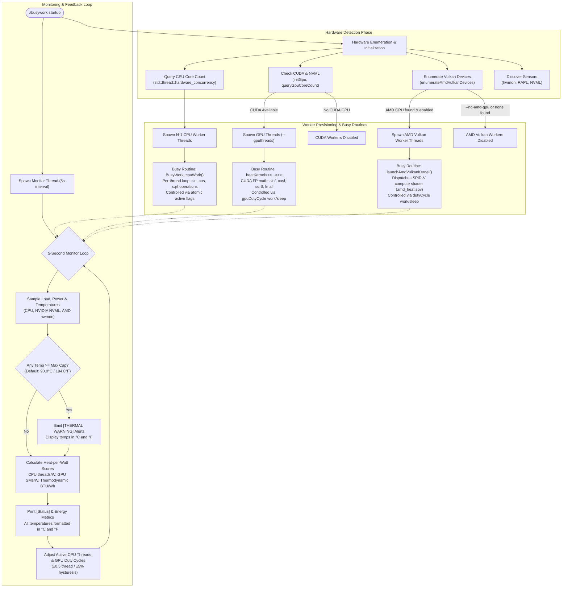

# Busywork - CPU/GPU Heat Generator

## Project Overview

**Busywork** is a C\+\+ application designed to generate controlled computational heat through CPU and GPU utilization for office warming purposes. The program dynamically adjusts workload intensity to maintain target utilization levels through real-time monitoring and adaptive thread management.

## Primary Functionality

The application serves as a computational heater by:
- Generating intensive floating-point operations on CPU threads
- Launching CUDA kernels on NVIDIA GPUs (when available)
- Launching Vulkan compute shaders on AMD GPUs (when available)
- Monitoring system resource utilization, power consumption, and temperatures in real-time
- Displaying temperatures in both Celsius (°C) and Fahrenheit (°F) for clarity
- Emitting thermal warnings when hardware temperatures exceed a configurable maximum cap (`--max-temp`)
- Tracking energy efficiency metrics and displaying "heat per watt" efficiency scores
- Comparing thermal yield (BTU/Wh) and percentage efficiency across heater types (electric, gas, heat pump)
- Calculating cumulative heat delivered to the room (in kJ, BTU, and kWh)
- Dynamically adjusting workload to match user-specified goals
- Providing graceful shutdown and comprehensive status reporting

## Languages & Technologies

| Component | Technology |
|-----------|------------|
| **Primary Language** | C\+\+17 |
| **GPU Language** | CUDA (C\+\+14) |
| **Build System** | GNU Make |
| **Threading** | C\+\+ Standard Library threads, pthread |
| **GPU APIs** | CUDA Runtime, NVML (NVIDIA Management Library) |
| **Platform** | Linux (uses `/proc/stat` for CPU monitoring) |

## Architecture

### System Design

The application follows a multi-threaded producer-consumer pattern with monitoring feedback loops:

1. **Main Thread**: Handles user input and program lifecycle
2. **Monitor Thread**: Periodically samples system load and adjusts worker activity
3. **CPU Worker Threads**: Execute intensive mathematical computations (N-1 cores by default)
4. **GPU Worker Threads**: Launch CUDA kernels with duty cycle control (configurable count)
5. **AMD Vulkan Workers**: Automatically launch one compute worker for every detected AMD Vulkan device with a compute queue

### Hardware Detection & Worker Routine Pipeline



### Key Components

#### CpuMonitor
Reads Linux `/proc/stat` to calculate system-wide CPU utilization:
- Tracks total CPU time vs. idle time deltas
- Returns load as "number of threads worth" (0.0 to `cpu_count`)
- Maintains state between measurements for accurate delta calculations

#### BusyWork
Main orchestrator managing all workers and monitoring:
- Initializes thread pools with atomic state flags
- Runs 5-second monitoring loop
- Adjusts CPU thread activation with ±0.5 thread hysteresis
- Adjusts GPU duty cycle with ±5% hysteresis
- Handles graceful shutdown coordination

#### GpuContext
Per-GPU-worker state structure:
- Device memory allocation for kernel output
- NVML device handle for load queries
- Initialization status tracking

#### AMD Vulkan Context
Per-device AMD compute state:
- Enumerates every Vulkan physical device and selects AMD devices with a compute queue, regardless of device index
- Creates an independent Vulkan device, queue, descriptor set, storage buffer, pipeline, and command buffer per AMD GPU
- Dispatches a SPIR-V compute shader with the same bounded floating-point workload pattern used by the CUDA backend
- Falls back per device: an unavailable AMD device does not disable CPU or CUDA workloads

#### EnergyMonitor & EnergyMetrics
Continuously samples hardware sensors and tracks power dissipation, temperatures, and heating efficiency:
- **CPU Monitoring**: Reads package temperature from Linux `hwmon` (`k10temp`, `coretemp`, `zenpower`) and power from `intel-rapl` sysfs (with automatic fallback to a dynamic TDP load model).
- **NVIDIA GPU Monitoring**: Queries live milliwatt power draw via NVML `nvmlDeviceGetPowerUsage` and GPU die temperature via `nvmlDeviceGetTemperature`.
- **AMD GPU Monitoring**: Reads power and temperature directly from `amdgpu` sysfs `hwmon`.
- **"Heat per Watt" Efficiency Scores**:
  - **Computational Efficiency**: Measures active compute workload delivered per watt of power (CPU `threads/W`, NVIDIA `SMs/W`, AMD `duty/W`) along with normalized 0–100 efficiency scores.
  - **Thermodynamic Heating Rating**: Formally verifies electrical-to-thermal dissipation rating ($1.000\text{ W}_{\text{heat}}/\text{W}_{\text{elec}} = 3.412\text{ BTU/Wh}$).
  - **Overall Heating Score**: Computes a power-weighted composite efficiency score (0–100) reflecting target heat fulfillment across all active components.
  - **Cumulative Thermal Energy**: Integrates instantaneous thermal power over elapsed time to display total heat delivered in kJ, BTU, and kWh.

### Control Algorithms

#### CPU Load Control
```
Every 5 seconds:
  1. Read /proc/stat counters
  2. Calculate utilization = (active_time) / (total_time) × cpu_count
  3. If current < target - 0.5: Activate one idle CPU thread
  4. If current > target + 0.5: Deactivate one active CPU thread
  5. Hysteresis prevents oscillation
```

#### GPU Load Control
```
Continuous per-worker loop:
  1. Launch CUDA kernel (gridSize=1024, blockSize=256, iterations=100000)
  2. Synchronize GPU
  3. Query GPU utilization via NVML (percentage)
  4. If load < target - 0.5: duty_cycle += 0.05
  5. If load > target + 0.5: duty_cycle -= 0.05
  6. Sleep for (1 - duty_cycle) × 50ms
```

The GPU duty cycle ranges from 0.0 (idle) to 1.0 (continuous work), controlling the work/sleep ratio.

#### AMD Vulkan Control
AMD Vulkan workers are automatic when eligible devices are found. They start at a continuous duty cycle because RADV does not expose an NVML-equivalent utilization API to this application. `--gpugoal` applies only to CUDA/NVML workers; AMD status reports device name, worker activity, and duty cycle rather than a hardware-utilization percentage.

## Build System

The Makefile implements conditional compilation:
- **CUDA Detection**: Checks for `/usr/local/cuda` directory
- **CPU-Only Build**: Always produces `busywork` executable
- **CUDA Build**: Conditionally includes GPU kernel compilation if CUDA toolkit present
- **Vulkan Build**: Conditionally includes AMD compute workers and SPIR-V shader compilation when Vulkan and `glslc` are available
- **Flags**: `-O3` optimization, `-std=c++17` for main, `-std=c++14` for CUDA
- **Libraries**: pthread, math (always); cudart and nvidia-ml (when CUDA enabled); Vulkan loader (when Vulkan enabled)

## Usage Patterns

### Command-Line Interface

```bash
# Default: (N-1) CPU threads at maximum, GPU at 99% if available
./busywork

# Specify CPU goal in "threads worth" (load average style)
./busywork --cpugoal 4.0   # Target 4 threads worth of CPU load

# Specify GPU goal (also in SMs worth, but duty cycle controlled)
./busywork --gpugoal 1.0

# Multiple GPU worker threads
./busywork --gputhreads 4 --gpugoal 1.5

# Disable automatic AMD Vulkan workers
./busywork --no-amd-gpu

# Set max temperature warning cap in °C (default: 90.0°C)
./busywork --max-temp 80.0
```

**Parameter Notes**:
- `--cpugoal`: Load goal measured as "number of threads worth" (float, typically 1.0 to `cpu_count`)
- `--gpugoal`: GPU load goal in SM-equivalent units (float, typically 0.0 to `sm_count`)
- `--gputhreads`: Number of host threads launching GPU work (integer, default 1)
- `--no-amd-gpu`: Disable automatic Vulkan workers for all detected AMD compute-capable GPUs
- `-m`, `--max-temp`: Maximum temperature threshold in °C before thermal warnings are triggered (float, default 90.0)

### Real-Time Status & Energy Efficiency Metrics

Every 5 seconds during execution, Busywork samples system utilization, temperatures, and power draw to output real-time workload status and energy efficiency scores:

```text
[Status]
  CPU Load: 32.0 / Goal: 31.0 threads | Active Workers: 30/31 | Temp: 91.2°C (196.2°F) | Power: 144.0 W (est.)
  GPU Load: 6144.0 / Goal: 6143.0 | Duty Cycle: 0.95 | Temp: 62.0°C (143.6°F) | Power: 176.3 W
  AMD Vulkan GPU: AMD Ryzen 9 9950X3D ... | Active: Yes | Duty Cycle: 1.00 | Temp: 47.0°C (116.6°F) | Power: 0.2 W
  >>> [THERMAL WARNING] Hardware temperature cap exceeded! <<<
  >>> [WARNING] CPU temperature 91.2°C (196.2°F) exceeded cap (90.0°C (194.0°F))!
  [Energy Efficiency & Heat Metrics]
    Total Thermal Power: 320.5 W (1093.5 BTU/h heat output)
    CPU Heat/Watt: 0.222 threads/W | Efficiency Score: 100.0/100
    GPU Heat/Watt: 34.85 SMs/W | Efficiency Score: 100.0/100
    AMD GPU Heat/Watt: 5.051 duty/W | Efficiency Score: 100.0/100
    Thermodynamic Heat-per-Watt: 3.412 BTU/Wh (1.000 W_heat/W_elec) | Overall Heating Score: 100.0/100
    Heater Benchmark Comparisons (3.412 BTU/Wh thermal conversion):
      - vs. Resistive Electric Space Heater: 100.0% parity (3.412 BTU/Wh)
      - vs. Standard Gas Furnace (80% AFUE):  125.0% on-site eff. (vs. 2.730 BTU/Wh-eq)
      - vs. High-Eff Condensing Gas (96%):    104.2% on-site eff. (vs. 3.276 BTU/Wh-eq)
      - vs. Air-Source Heat Pump (COP 3.0):    33.3% heat moved (vs. 10.236 BTU/Wh)
    Cumulative Heat Delivered: 125.4 kJ (118.8 BTU / 0.0348 kWh)
---
```

**Metrics Explained**:
- **Total Thermal Power**: Instantaneous thermal heat generation rate in Watts and BTU/h ($1\text{ W} = 3.412142\text{ BTU/h}$).
- **CPU Heat/Watt**: Computational heating load per Watt of CPU power draw (`threads/W`) with normalized efficiency score.
- **GPU Heat/Watt**: Compute density per Watt of GPU power (`SMs/W` for CUDA, `duty/W` for AMD Vulkan) with normalized score.
- **Thermodynamic Heat-per-Watt**: Space-heater resistive heating coefficient ($1.000\text{ W}_{\text{heat}}/\text{W}_{\text{elec}} = 3.412\text{ BTU/Wh}$) and composite overall heating score reflecting goal fulfillment.
- **Cumulative Heat Delivered**: Total thermal energy produced since startup in kilojoules (kJ), British Thermal Units (BTU), and kilowatt-hours (kWh).
- **Dual Temperature Display**: Real-time die temperatures in both Celsius (°C) and Fahrenheit (°F) via NVML (NVIDIA) and Linux hwmon (`k10temp`/`coretemp` for CPU, `amdgpu` for AMD).
- **Thermal Warnings**: Prominent `[THERMAL WARNING]` alerts displayed when any monitored CPU or GPU component temperature equals or exceeds the configured `--max-temp` threshold.

#### Heating Efficiency Benchmark Comparisons (BTU/Wh & Percentage vs. Other Heater Types)

How does computational heating in Busywork compare against traditional household and office heating appliances?

| Heating Technology | Thermal Yield | Conversion Efficiency / COP | Busywork Relative Yield (%) | Comparison Analysis |
|--------------------|--------------|-----------------------------|-----------------------------|---------------------|
| **Busywork (CPU/GPU)** | **3.412 BTU/Wh** | **100% (COP 1.00)** | **100.0%** (Baseline) | All electrical power consumed by CPU/GPU is converted to thermal dissipation into the room |
| **Resistive Electric Space Heater** | 3.412 BTU/Wh | 100% (COP 1.00) | **100.0%** (Parity) | Direct Joule resistance wire heating ($P = I^2 R$); identical thermal output per kWh consumed |
| **Standard Gas Furnace** | 2.730 BTU/Wh-eq | 80% AFUE | **125.0%** | Conventional gas combustion exhausts ~20% of fuel energy out the chimney/flue |
| **High-Efficiency Condensing Gas** | 3.276 BTU/Wh-eq | 96% AFUE | **104.2%** | Modern condensing heat exchanger recaptures water vapor latent heat; Busywork delivers 104.2% on-site room yield |
| **Air-Source Heat Pump** | 10.236 BTU/Wh | 300% (COP 3.00) | **33.3%** | Heat pumps move existing outdoor ambient heat indoors; resistive heating (and Busywork) delivers ~1/3 the heat per electrical Wh |

### Shutdown
Press Enter to initiate graceful shutdown. All worker threads are joined before exit.

## Testing Strategy

### Manual Verification
1. **CPU Testing**: Run with `--cpugoal 0.5`, monitor with `htop` or `mpstat 5` to verify ~50% utilization
2. **GPU Testing**: Run `--gpugoal 0.8 --gputhreads 2`, monitor with `nvidia-smi -l 1` or `nvtop`
3. **Dynamic Adjustment**: Start with low goal, observe thread activation in status output
4. **AMD Vulkan Testing**: Run normally, confirm each detected AMD Vulkan worker is listed at startup, then use `--no-amd-gpu` to verify the opt-out path

### No Automated Tests
The project currently lacks unit/integration tests. Testing is performed via:
- Visual monitoring of system utilization tools
- Status output validation
- Build verification on target platforms

## Enhancement Ideas

### High Priority
1. **Cross-Platform Support**: Abstract CPU monitoring for Windows (`GetSystemTimes`) and macOS (`host_processor_info`)
2. **Multi-GPU Support**: Extend to support multiple NVIDIA GPUs with per-device targeting
3. **Configuration File**: Support YAML/JSON config for persistent settings
4. **Temperature Monitoring**: *(Implemented)* Real-time hardware temperature monitoring via NVML and Linux hwmon (`k10temp`/`coretemp`/`amdgpu`)

### Medium Priority
5. **Web Dashboard**: Real-time monitoring via embedded HTTP server (e.g., using Crow or Pistache)
6. **Adaptive Kernel Sizing**: Dynamically adjust CUDA grid/block based on GPU architecture
7. **Power Consumption Display**: *(Implemented)* Live wattage measurement via NVML and Linux sysfs / RAPL with thermal model fallback
8. **Scheduled Operation**: Time-based activation profiles (e.g., "warm office 8-10am weekdays")

### Low Priority / Experimental
9. **Additional AMD GPU Backends**: Optional ROCm/HIP support beyond the built-in Vulkan backend
10. **Intel GPU Support**: Level Zero or OpenCL backend
11. **Distributed Heating**: Network coordination of multiple machines
12. **Machine Learning Workloads**: Replace synthetic math with real ML inference for dual-purpose heating

### Code Quality
13. **Unit Tests**: Google Test framework for CpuMonitor, configuration parsing
14. **Integration Tests**: End-to-end scenarios with mocked `/proc/stat` and NVML
15. **CI/CD Pipeline**: GitHub Actions for multi-platform builds
16. **Static Analysis**: clang-tidy, cppcheck integration
17. **Documentation**: Doxygen-generated API docs

## Suggestions for Improvement

### Functionality
- **Safety Limits**: Hard caps on temperature to prevent hardware damage (via `nvmlDeviceGetTemperature`)
- **Energy Efficiency Metrics**: *(Implemented)* Real-time "heat per watt" efficiency scores, thermal dissipation ratings (BTU/Wh), and cumulative heat delivered
- **Profile Presets**: Named profiles like `--profile office-morning` for common scenarios
- **Logging**: Structured logs to `logs/` directory with timestamps and utilization history

### Architecture
- **Plugin System**: Modular backend selection (CUDA, ROCm, OpenCL) via runtime loading
- **State Machine**: Explicit FSM for startup → active → cooldown → shutdown states
- **Configuration Validation**: Schema validation for config files with helpful error messages
- **Resource Cleanup**: RAII wrappers for CUDA and NVML resources to prevent leaks

### Developer Experience
- **CMake Migration**: More portable build system than Makefile
- **Containerization**: Docker image with CUDA support for reproducible builds
- **Documentation**: Architecture diagrams using Mermaid or PlantUML
- **Code Style**: Enforce consistent style with `.clang-format`

## Code Reference Table

| Class/Function | File | Line | Description |
|----------------|------|------|-------------|
| `CpuMonitor` (class) | src/main.cpp | 24 | Monitors system-wide CPU utilization via `/proc/stat`, calculates load as "threads worth" |
| `CpuMonitor::getCpuLoad` | src/main.cpp | 34 | Reads `/proc/stat`, calculates delta utilization since last call, returns float representing "N threads worth" |
| `EnergyMetrics` (struct) | src/main.cpp | 65 | Data container for power, temperature, heat-per-watt efficiency scores, and cumulative heating energy |
| `EnergyMonitor` (class) | src/main.cpp | 95 | Scans hwmon/sysfs/RAPL sensors, queries GPU power & temps, computes efficiency metrics |
| `BusyWork` (class) | src/main.cpp | 325 | Main orchestrator managing CPU/GPU workers, monitoring loop, and lifecycle |
| `BusyWork::cpuWork` | src/main.cpp | 355 | CPU worker thread function: performs intensive sin/cos/sqrt operations when active flag is set |
| `BusyWork::monitor` | src/main.cpp | 374 | Monitoring loop: runs every 5 seconds, samples load & energy metrics, adjusts threads, prints status |
| `BusyWork::printStatus` | src/main.cpp | 443 | Outputs CPU/GPU load, temperatures, power consumption, and energy efficiency metrics |
| `BusyWork::gpuWorker` | src/main.cpp | 520 | GPU worker thread function: launches CUDA kernels with duty cycle control based on atomic `gpuDutyCycle` |
| `BusyWork::getGpuLoad` | src/main.cpp | 550 | Wrapper for `queryGpuLoad()` from GPU module |
| `BusyWork::BusyWork` | src/main.cpp | 555 | Constructor: initializes goals, queries GPU capabilities, sets defaults (N-1 threads) |
| `BusyWork::printCapabilities` | src/main.cpp | 600 | Prints system CPU/GPU capabilities, active monitoring, and current configuration to console |
| `BusyWork::~BusyWork` | src/main.cpp | 670 | Destructor: calls `stop()` to ensure graceful shutdown |
| `BusyWork::start` | src/main.cpp | 674 | Starts all CPU worker threads, GPU worker threads (if available), and monitor thread |
| `BusyWork::stop` | src/main.cpp | 715 | Sets running flag to false and joins all worker threads |
| `BusyWork::waitForSignal` | src/main.cpp | 740 | Blocks on stdin, calls `stop()` when user presses Enter |
| `printUsage` | src/main.cpp | 750 | Displays command-line help text with available options |
| `main` | src/main.cpp | 760 | Entry point: parses arguments, instantiates BusyWork, starts workers, waits for shutdown signal |
| `GpuContext` (struct) | src/gpu_kernel.cu | 26 | Per-worker GPU state: device memory pointer, NVML device handle, initialization flag |
| `heatKernel` (GPU kernel) | src/gpu_kernel.cu | 33 | CUDA kernel: each thread performs `iterations` floating-point operations (sin, cos, sqrt, FMA) |
| `initGpu` | src/gpu_kernel.cu | 50 | Allocates device memory, initializes NVML, returns GpuContext or nullptr on failure |
| `cleanupGpu` | src/gpu_kernel.cu | 71 | Frees device memory, shuts down NVML, deletes GpuContext |
| `launchGpuKernel` | src/gpu_kernel.cu | 85 | Launches `heatKernel` with specified grid/block dimensions and iteration count, synchronizes device |
| `queryGpuLoad` | src/gpu_kernel.cu | 120 | Queries current GPU utilization percentage via NVML, converts to "SMs worth" (percentage × SM count) |
| `queryGpuPowerWatts` | src/gpu_kernel.cu | 137 | Queries live GPU power consumption in Watts via NVML `nvmlDeviceGetPowerUsage` |
| `queryGpuTemperature` | src/gpu_kernel.cu | 150 | Queries live GPU die temperature in °C via NVML `nvmlDeviceGetTemperature` |
| `queryGpuCoreCount` | src/gpu_kernel.cu | 167 | Returns number of GPU streaming multiprocessors via NVML or CUDA runtime property query |
| `GpuContext` (declaration) | src/gpu_worker.h | 6 | Forward declaration for GPU worker state structure |
| `initGpu` (declaration) | src/gpu_worker.h | 13 | C linkage function to initialize GPU context for worker thread |
| `cleanupGpu` (declaration) | src/gpu_worker.h | 16 | C linkage function to cleanup GPU resources |
| `launchGpuKernel` (declaration) | src/gpu_worker.h | 19 | C linkage function to launch compute kernel on GPU |
| `queryGpuLoad` (declaration) | src/gpu_worker.h | 22 | C linkage function to query current GPU load as SMs worth |
| `queryGpuCoreCount` (declaration) | src/gpu_worker.h | 25 | C linkage function to query number of GPU multiprocessors |
| `queryGpuPowerWatts` (declaration) | src/gpu_worker.h | 28 | C linkage function to query live GPU power consumption in Watts |
| `queryGpuTemperature` (declaration) | src/gpu_worker.h | 31 | C linkage function to query live GPU temperature in °C |

---

**Document Metadata**
- **Generated**: 2026-01-23
- **Source Repository**: `/run/media/michael/FAST_ARCHIVE/Programming/busywork`
- **Source Files Analyzed**: 3 (main.cpp, gpu_kernel.cu, gpu_worker.h)
- **Total Lines of Code**: ~536 (including comments/whitespace)
- **Build System**: Makefile with CUDA auto-detection
- **Platform**: Linux (CachyOS)

